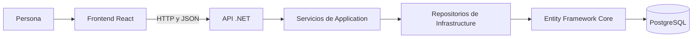
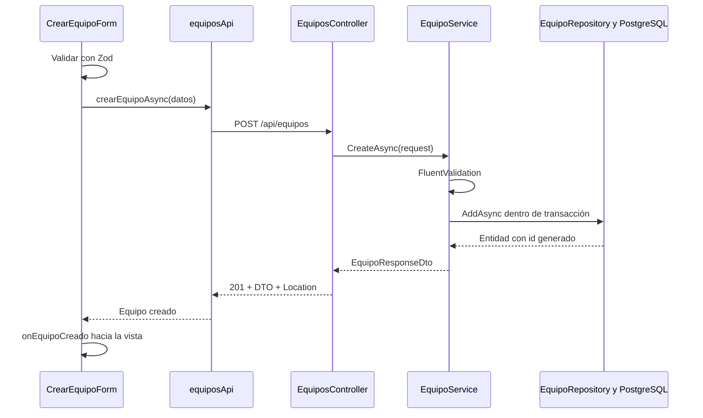

# Guía para entender el Sistema de Préstamos de Equipo

Esta guía está escrita para estudiar el código real de este repositorio, desde cero. No necesitas entender todos los archivos a la vez: primero sigue un equipo desde la pantalla hasta la base de datos. Después estudia usuarios y préstamos, que reutilizan muchas de las mismas ideas.

**Estado del proyecto:** el backend gestiona usuarios, equipos, préstamos y devoluciones. El frontend permite consultar, buscar, registrar y eliminar equipos. Las pantallas de usuarios, los préstamos desde React y la edición de equipos todavía no están implementadas. Un botón deshabilitado no realiza una operación.

## Cómo usar esta guía

Lee las secciones 1 a 5 para ubicarte. Después abre el editor junto a las secciones 6 a 10. Por último, sigue los recorridos completos y los ejercicios. Los enlaces apuntan a archivos del repositorio; dentro del editor puedes buscar los nombres de las funciones indicadas.

El material de las clases usa HabitForge como ejemplo. Aquí aplicamos sus conceptos a equipos. Algunas decisiones son propias del proyecto: reglas en servicios, transacciones, ilustraciones y confirmación de borrado. No son requisitos literales de todos los ejemplos del curso.

## 1. Qué problema resuelve cada parte

Imagina un mostrador de préstamos. El frontend es el mostrador que ve la persona; la API recibe las solicitudes; Application comprueba si se pueden realizar; Infrastructure sabe dónde están los registros; PostgreSQL los conserva.



Una solicitud real recorre esas piezas; sus dependencias de código no son exactamente las mismas flechas. Por ejemplo, un servicio conoce una interfaz de repositorio, no la clase concreta de Infrastructure. Esa diferencia es el principio DIP de la clase 5.

| Carpeta | Responsabilidad | Clases relacionadas |
| --- | --- | --- |
| `Backend` | API, reglas y acceso a datos | 1–9 |
| `Infra` | Configuración de PostgreSQL en Docker | 4 |
| `frontend` | Pantalla e interacción del navegador | 10–17 |
| `SEGUIMIENTO_CLASES.md` | Decisiones y evaluaciones de las clases | Todas |

## 2. Vocabulario antes de abrir el código

| Palabra | Significado en este proyecto |
| --- | --- |
| Variable | Nombre que permite referirse a un valor. |
| Objeto | Grupo de datos con propiedades: `{ nombre: 'Laptop', tipo: 'Portátil' }`. |
| Array o colección | Lista de valores: la colección de equipos. |
| Función o método | Bloque con una tarea: obtener equipos, validar o guardar. |
| Clase C# | Definición para construir objetos con datos o comportamiento. |
| Interfaz | Contrato. En C# puede exigir métodos; en TypeScript describe la forma de un valor. |
| Tipo | Clase de valor admitido: texto, número, booleano, etc. |
| `null` | Ausencia de un valor. En `errorCarga` significa que no hay error registrado. |
| `string` / `number` / `boolean` | Texto, número y verdadero/falso en TypeScript. En C# usamos, entre otros, `string`, `int` y `bool`. |
| DTO | Datos que entran o salen de la API. No es necesariamente una entidad de base de datos. |
| Endpoint | Dirección y método HTTP atendidos por la API. |
| JSON | Formato de texto para transportar datos entre frontend y backend. |
| Estado React | Memoria de una instancia de componente que puede provocar una nueva representación. |
| Prop | Dato o función que un componente padre entrega a un hijo. |
| Callback | Función que entregamos a otro componente para que la invoque cuando ocurra algo. |
| Promise / Task | Representación de un trabajo que puede terminar después: Promise en JavaScript; Task en C#. |

`async` permite usar `await`. `await` espera el resultado de una operación asíncrona dentro de esa función; no significa que se congele toda la aplicación. `try` intenta, `catch` gestiona el fallo y `finally` ejecuta la limpieza tanto si hubo éxito como si hubo error.

## 3. Relación con las clases 1 a 17

| Clase | Qué estudiaste | Dónde verlo |
| --- | --- | --- |
| 1 | Cliente-servidor, HTTP, API-First y monorepo | Frontend separado del backend y contratos REST. |
| 2 | SOLID y código limpio | Responsabilidades de controladores, servicios y repositorios. Tener carpetas no demuestra por sí solo todos los principios. |
| 3 | Clean Architecture y referencias | Cuatro proyectos .NET: API, Application, Domain e Infrastructure. |
| 4 | Docker, ORM y variables de entorno | `Infra/compose.yaml`, `.env`, `AppDbContext` y Npgsql. |
| 5 | Repositorios, DIP e inyección de dependencias | `Application/Interfaces` e `Infrastructure/Repositories`; registros `AddScoped`. |
| 6 | Migraciones, HTTP y controladores | Migración inicial, `EquiposController` y GET/POST. |
| 7 | OpenAPI, Scalar y archivos HTTP | `Program.cs`, `/scalar/v1` y `PrestamosEquipos.API.http`. |
| 8 | DTOs, FluentValidation y features | `Application/Features/*/DTOs` y `Validators`. |
| 9 | Consulta individual, actualización y borrado | GET por id, PUT y DELETE del backend. |
| 10 | Vite, TypeScript, renderizado y estructura React | `index.html`, `main.tsx`, `vite.config.ts` y configuraciones TypeScript. |
| 11 | Componentes funcionales, JSX y props | `EquipoCard`, `Icono` y `EquipoIlustracion`. |
| 12 | Design system, Tailwind, Flexbox y Grid | `index.css`, `AppLayout` y clases de las tarjetas. |
| 13 | Estado, efectos, búsqueda, listas y limpieza | `CatalogoEquiposView`, `useState`, `useEffect`, `filter` y `map`. |
| 14 | Features, composición y `children` | `AppLayout`, `features/equipos` y `App`. |
| 15 | Axios, configuración y CORS | `equiposApi.ts`, `.env.example` y política `Frontend` de .NET. |
| 16 | POST, errores, Zod y React Hook Form | `CrearEquipoForm`, `equipo.schema.ts` y extractor de errores. |
| 17 | Integración POST/DELETE | Actualización de la lista tras guardar y borrar con respuesta real del servidor. |

Las clases 13–17 se implementaron juntas: el código final usa datos reales. Por eso no encontrarás una espera artificial de 1,2 segundos ni seis equipos quemados en un temporizador. Ese era el paso didáctico previo a conectar la API.

## 4. Cómo se inicia todo

Hay tres procesos: PostgreSQL, API y Vite. Que Vite funcione no demuestra que la API esté disponible; que la API arranque no demuestra que todas las consultas a la base funcionen.

### Preparar configuración

Desde la raíz, crea tus archivos locales a partir de las plantillas si todavía no existen:

- `Infra/.env.example` → `Infra/.env`.
- `Backend/Sistema-Prestamos-de-Equipos/PrestamosEquipos.API/example.env` → `.env` en esa misma carpeta.
- `frontend/.env.example` → `frontend/.env`.

Los valores de base, usuario y contraseña deben coincidir entre el contenedor y la cadena de conexión de la API. Nunca publiques sus valores reales. El `.env` del frontend contiene una URL pública, no la contraseña de PostgreSQL:

```dotenv
VITE_API_BASE_URL=http://localhost:5024/api
```

Las variables `VITE_*` forman parte del código que recibe el navegador. No son una caja de secretos.

### Terminal 1: base de datos

Con Docker Desktop iniciado, desde la raíz:

```powershell
docker compose -f Infra/compose.yaml up -d
```

El volumen conserva la base al detener el contenedor. No borres el volumen para solucionar un error de conexión.

### Preparación inicial de .NET

Desde la raíz:

```powershell
cd Backend/Sistema-Prestamos-de-Equipos
dotnet tool restore
dotnet restore
dotnet build
dotnet ef database update --project PrestamosEquipos.Infrastructure --startup-project PrestamosEquipos.API
```

Esto usa la migración existente; no debes generar otra migración inicial. No necesitas ejecutar estos pasos completos cada vez que abres el navegador. El SDK instalado se mantiene según la decisión del proyecto.

### Terminal 2: API

Desde la raíz:

```powershell
cd Backend/Sistema-Prestamos-de-Equipos/PrestamosEquipos.API
dotnet run --launch-profile http
```

Se inicia en `http://localhost:5024`. Se ejecuta desde la carpeta API para que `Env.Load()` encuentre el archivo local. En desarrollo puedes explorar [Scalar](http://localhost:5024/scalar/v1).

### Terminal 3: React

Desde la raíz:

```powershell
cd frontend
pnpm install
pnpm run dev --host localhost --port 5173 --strictPort
```

Abre `http://localhost:5173`. El host importa: `127.0.0.1` es un origen distinto de `localhost`. El puerto fijo evita que Vite cambie a 5174 silenciosamente y deje de coincidir con CORS.

Para detener API o Vite, usa Ctrl+C en su terminal. Reinicia Vite al cambiar `.env`. Las instrucciones de backend están también en [BACKEND.md](Backend/BACKEND.md).

## 5. Los datos: entidad, DTO y props no son lo mismo

La base tiene tres tablas principales: Usuarios, Equipos y Prestamos. Un préstamo relaciona un usuario y un equipo mediante sus identificadores. Un usuario puede tener muchos préstamos; un equipo puede tener muchos préstamos a lo largo del tiempo.

Una **entidad** representa el modelo interno. `Prestamo` tiene `UsuarioId`, `EquipoId` y propiedades de navegación `Usuario` y `Equipo`. EF utiliza esas relaciones para trabajar con los datos.

Un **DTO de entrada** controla qué puede pedir el cliente. Crear un equipo envía:

```json
{
  "nombre": "Laptop de trabajo",
  "tipo": "Computadora portátil",
  "estado": "Disponible"
}
```

No envía id: lo genera el servidor/base de datos. El **DTO de respuesta** añade ese id y no expone colecciones de préstamos ni relaciones EF:

```json
{
  "id": 42,
  "nombre": "Laptop de trabajo",
  "tipo": "Computadora portátil",
  "estado": "Disponible"
}
```

El 42 solo ilustra el formato; no es un id que debas copiar a tu base.

En C# las propiedades se llaman `Nombre` y `Tipo`; en el JSON habitual de esta API aparecen como `nombre` y `tipo`. Los tipos TypeScript del frontend siguen ese JSON. Las claves del diccionario de errores pueden conservar `Nombre` con mayúscula.

`EquipoCardProps` añade funciones y estado visual, como `onEliminar` y `eliminando`. Esas props solo existen en React: no viajan en el POST. Separar datos y acciones evita contaminar los DTOs con detalles de pantalla.

## 6. El backend, archivo por archivo

La solución está en `Backend/Sistema-Prestamos-de-Equipos/PrestamosEquipos.slnx`. Los `.csproj` indican SDK, paquetes y referencias entre proyectos. La referencia es lo que permite que un proyecto utilice tipos de otro.

### Domain: entidades y nombres válidos

Abre `PrestamosEquipos.Domain/Entities`. `Usuario`, `Equipo` y `Prestamo` son clases con propiedades. `get; set;` permite leer y asignar la propiedad. `string.Empty` inicializa un texto vacío. `DateTime?` permite una fecha o null: la fecha real de devolución no existe hasta que devuelven el equipo.

Las clases de `Constants` concentran los textos de estados. Evitan escribir variantes como prestado/Prestado por accidente en distintos archivos. No contienen consultas a la base.

El proyecto mantiene las reglas de los casos de uso en los **servicios de Application**, por decisión explícita. Las entidades no tienen que convertirse ahora en clases con toda la lógica solo para imitar otra arquitectura.

### Application: contratos, validación y reglas

Dentro de `Features` hay Equipos, Usuarios y Prestamos. Cada feature agrupa DTOs, validadores y su servicio. No son tres bases diferentes: comparten el contexto y las tablas.

| Grupo | Qué leer y qué buscar |
| --- | --- |
| `DTOs` | Propiedades de entrada/salida. Los de actualización reciben datos completos para PUT; el id lo entrega la ruta. |
| `Validators` | `RuleFor` expresa reglas de campos; `NotEmpty`, `MaximumLength`, ids positivos y estados permitidos. |
| `EquipoService` | `CreateAsync`, `UpdateAsync`, `DeleteAsync` y `ToResponse`. |
| `UsuarioService` | Normalización del correo, comprobación de unicidad y preservación del historial. |
| `PrestamoService` | Disponibilidad, cupo, fechas y devolución. |
| `Common/Exceptions.cs` | Excepciones de inexistencia y conflicto que después traduce la API. |
| `Interfaces` | Qué operaciones de datos necesitan los servicios, sin depender de EF. |

En `EquipoService.CreateAsync`, lee en este orden:

1. `ValidateAndThrowAsync(request)` ejecuta FluentValidation. Si falla, salta al manejador de excepciones.
2. `unitOfWork.ExecuteAsync(...)` abre la operación transaccional.
3. Construye `new Equipo` con los datos de entrada; recorta espacios del nombre y tipo.
4. `equipos.AddAsync(equipo)` guarda mediante el repositorio.
5. `ToResponse(...)` convierte entidad en DTO de respuesta.

`ToResponse` es mapeo manual. Permite elegir los datos públicos sin instalar otro sistema de mapeo.

Las interfaces `IEquipoRepository`, `IUsuarioRepository` e `IPrestamoRepository` dicen **qué se puede pedir**. Infrastructure dice **cómo se cumple**. `Task<Equipo?>` significa que el resultado asíncrono puede ser un equipo o null.

### Infrastructure: cómo se guardan los datos

| Archivo o carpeta | Responsabilidad |
| --- | --- |
| `Data/AppDbContext.cs` | Punto de acceso EF: `Usuarios`, `Equipos` y `Prestamos` son `DbSet`. Carga configuraciones de entidades. |
| `Configurations` | Tablas, longitudes, obligatoriedad, correo único y relaciones/restricciones. |
| `Repositories` | Consultas y escrituras reales usando EF Core. |
| `Data/Migrations` | Historial de cambios del esquema. El snapshot describe el último modelo generado. |
| `Data/UnitOfWork.cs` | Transacción y tratamiento de ciertas colisiones de PostgreSQL. |
| `DependencyInjection.cs` | Registra contexto, proveedor Npgsql, repositorios y UnitOfWork. |

En `EquipoRepository.GetAllAsync`, `AsNoTracking` consulta sin preparar cambios sobre esas entidades, `Where` añade un filtro cuando se pide estado, `OrderBy` ordena y `ToListAsync` ejecuta la consulta. EF traduce la consulta a SQL; React no recibe SQL.

En `AddAsync`, añadir una entidad al contexto no basta: `SaveChangesAsync` envía los cambios. En `DeleteAsync`, `Remove` prepara el borrado y `SaveChangesAsync` lo ejecuta. `FindAsync(id)` permite buscar por clave primaria.

### Transacciones: por qué hay un UnitOfWork

Para prestar un equipo deben ocurrir dos cosas juntas: crear el préstamo y marcar el equipo como Prestado. No queremos que solo se guarde una de ellas.

`UnitOfWork.ExecuteAsync` abre una transacción Serializable y ejecuta una función recibida. `CommitAsync` confirma el conjunto. Si ocurre una colisión de serialización o deadlock de PostgreSQL, hace rollback, limpia el seguimiento de EF y reintenta con un límite. El límite evita reintentos infinitos. Ciertos errores de unicidad/relaciones se convierten en conflictos comprensibles.

No confundas `SaveChangesAsync` con `CommitAsync`: aquí cada repositorio guarda dentro de una transacción todavía pendiente; el commit confirma el conjunto. Es una decisión propia para preservar coherencia ante concurrencia, no una obligación literal de los ejemplos básicos.

### API: entrada HTTP y composición

Abre `PrestamosEquipos.API/Program.cs`:

- `CreateBuilder` prepara configuración y servicios.
- `Env.Load` carga variables del archivo local. La cadena se obtiene directamente de variables de entorno y se comprueba que exista.
- `AddApplication` registra servicios de casos de uso y validadores.
- `AddInfrastructure` conecta PostgreSQL e implementaciones de repositorios.
- `AddExceptionHandler` y `AddProblemDetails` preparan respuestas coherentes a errores.
- `AddCors` define quién puede leer respuestas desde otros orígenes del navegador.
- `AddControllers` y `MapControllers` registran y publican los controladores.
- `AddOpenApi`, `MapOpenApi` y Scalar generan/presentan documentación en Development.
- `UseExceptionHandler`, redirección HTTPS, CORS y autorización forman parte del pipeline; `Run` inicia el servidor.

**Inyección de dependencias:** el controlador pide un `EquipoService` en su constructor; .NET lo construye con sus repositorios y validadores. No hacemos `new EquipoRepository(...)` en el controlador. `AddScoped` comparte una instancia por alcance de solicitud; `TimeProvider.System` se registra singleton para obtener la hora del servidor.

**DIP y DI son distintos:** DIP explica por qué el servicio depende de una interfaz; DI explica cómo recibe una implementación concreta al ejecutarse.

Los controladores `EquiposController`, `UsuariosController` y `PrestamosController` convierten HTTP en llamadas a servicios. `[HttpGet]`, `[HttpPost]`, `[HttpPut]` y `[HttpDelete]` indican el verbo. `[FromBody]` lee JSON; `[FromQuery]` lee filtros de la URL. `[ApiController]` ayuda con errores de binding del cuerpo.

`CreatedAtAction` devuelve 201 y una cabecera Location que apunta al recurso individual. `NoContent()` devuelve 204 sin JSON de respuesta. Es el motivo por el que DELETE no espera un `Equipo` como resultado.

## 7. Reglas del negocio que debes conocer

| Área | Regla actual |
| --- | --- |
| Usuario | Nombre obligatorio hasta 100; correo obligatorio hasta 150 y con formato válido. Se recorta y normaliza a minúsculas. No se repite sin distinguir mayúsculas. |
| Equipo | Nombre obligatorio hasta 100; tipo libre obligatorio hasta 250. No hay mínimo de tres caracteres ni regex de nombres de hábitos. |
| Crear equipo | Solo Disponible o Mantenimiento. Prestado se asigna al crear un préstamo. |
| Editar equipo | No liberar uno con préstamo activo ni asignar Prestado sin préstamo. |
| Registrar préstamo | Usuario/equipo existentes, equipo disponible y usuario con menos de cuatro préstamos activos. |
| Fecha límite | Dos meses calendario desde FechaPrestamo. No son siete días ni necesariamente sesenta días. |
| Devolución | Solo un préstamo activo puede devolverse; se registra fecha real y el equipo pasa a Disponible. |
| Borrado | No se elimina usuario/equipo con cualquier historial de préstamos, aunque ya esté devuelto. No existe DELETE de préstamos. |

`PrestamoService` utiliza la hora UTC del servidor. `FechaLimite` se calcula al construir el DTO con `AddMonths(2)`; no es otra columna de la tabla. Las fechas no las controla el formulario.

## 8. Errores: cómo llegan al navegador

`ApiExceptionHandler` transforma excepciones en respuestas HTTP:

| Código | Significado y ejemplo |
| --- | --- |
| 200 | Consulta correcta. |
| 201 | Creación correcta, con equipo de respuesta. |
| 204 | Actualización/borrado/devolución correcta, sin cuerpo. |
| 400 | Entrada inválida; por ejemplo tipo vacío. |
| 404 | El recurso solicitado ya no existe. |
| 409 | Conflicto de negocio; por ejemplo equipo con historial. |
| 500 | Fallo inesperado, sin revelar los detalles internos. |

Una respuesta de validación propia se parece a esto:

```json
{
  "status": 400,
  "title": "Los datos de la solicitud no son válidos.",
  "errors": {
    "Tipo": ["El campo Tipo no puede estar vacío."]
  }
}
```

La frase es ilustrativa; el frontend muestra los mensajes que realmente entregue el backend. Este contrato **es un objeto con `errors`**, no el arreglo `ValidationFailure[]` del ejemplo de clase 16. No cambiamos el backend para que coincida con el ejemplo ajeno.

En `equiposApi.ts`, `extraerMensajeErrorBackend` recibe `unknown`: todavía no sabe qué falló. Comprueba si es Axios, si existe respuesta, si hay mensajes por campo o `detail`/`title`. Un 500 conserva un mensaje genérico. Un error sin respuesta puede ser de red, timeout o CORS; no afirma que siempre sea CORS.

No se reintenta automáticamente un POST fallido: si se perdió la respuesta, puede haberse guardado el equipo. Primero actualiza el catálogo para evitar duplicarlo.

## 9. El frontend: de HTML a módulos React

### Archivos de arranque y configuración — clases 10 y 12

`index.html` contiene el contenedor root y carga `src/main.tsx`. `main.tsx` ejecuta `createRoot(...).render(<App />)` y carga `index.css`. JSX se parece a HTML, pero admite expresiones entre llaves y componentes con mayúscula. Usamos `className` en lugar de `class`.

`vite.config.ts` conserva el plugin React, React Compiler mediante Babel y Tailwind. Vite sirve el proyecto en desarrollo y prepara la versión distribuible. El script build también ejecuta TypeScript, no solo empaqueta.

`tsconfig.json` referencia las configuraciones de aplicación y de Vite. `types: ['vite/client']` aporta los tipos de Vite; no hace falta duplicarlos con un archivo `vite-env.d.ts` en esta plantilla. `package.json` enumera paquetes y comandos; `pnpm-lock.yaml` fija las resoluciones de dependencias. `node_modules` y `dist` se regeneran y no se versionan.

`index.css` importa Tailwind. Los tokens ink, canvas y brand dan nombres coherentes a colores de la aplicación. `grid-cols-1 sm:grid-cols-2 lg:grid-cols-3` distribuye tarjetas; `md:hidden` y `hidden md:flex` alternan las piezas móviles/de escritorio. No se añaden pantallas por cambiar el CSS.

### Organización por funcionalidad — clase 14

```text
src/
  App.tsx
  main.tsx
  index.css
  components/Icono.tsx
  layouts/AppLayout.tsx
  features/equipos/
    types/equipo.types.ts
    schemas/equipo.schema.ts
    api/equiposApi.ts
    components/
      CatalogoEquiposView.tsx
      CrearEquipoForm.tsx
      EquipoCard.tsx
      EquipoIlustracion.tsx
```

`App` solo compone `<AppLayout><CatalogoEquiposView /></AppLayout>`. Todo lo que está entre las etiquetas del layout se entrega mediante `children`. `ReactNode` describe el contenido que puede recibir. El layout conserva sidebar, cabecera, main y footer; no consulta equipos.

`Icono` es compartido porque el layout lo usa. Las ilustraciones y tarjetas de equipos viven con su módulo. Una carpeta feature no es un servicio web separado: es organización del código.

### Tipos y props — clase 11

Abre `types/equipo.types.ts`. `Equipo` describe los cuatro datos de salida y `CrearEquipoDto` los tres de entrada. `estado: 'Disponible' | 'Mantenimiento'` es una unión: solo permite esos dos textos al crear.

`import type` utiliza una definición para comprobar tipos, sin necesitar un objeto JavaScript en ejecución. `export` permite importarla desde otros archivos. App utiliza `export default`; los componentes hijos utilizan exportaciones nombradas, como las clases.

En `EquipoCard`, `{ id, nombre, tipo, estado }` es desestructuración: extrae propiedades de las props sin escribir `props.nombre` repetidamente. `extends Equipo` reutiliza los datos del contrato y añade props visuales/acciones. La tarjeta no cambia sus props ni elimina registros por su cuenta.

`EquipoIlustracion` representa gráficamente algunos tipos y tiene una imagen genérica para otros. Las ilustraciones son SVG decorativos propios; no crean un campo imagen en el backend. El tipo continúa siendo texto libre.

## 10. El catálogo reactivo, paso a paso — clases 13 a 17

Abre `CatalogoEquiposView.tsx` y localiza cada nombre:

| Estado | Valor inicial | Para qué sirve |
| --- | --- | --- |
| `equipos` | `[]` | Colección recibida de la API. |
| `cargando` | `true` | Mantiene visible la espera durante GET. |
| `errorCarga` | `null` | Fallo al leer el catálogo. |
| `busqueda` | `''` | Texto introducido en el buscador. |
| `mostrarFormulario` | `false` | Decide si se muestra CrearEquipoForm. |
| `equipoAEliminar` | `null` | Selección pendiente de confirmación. |
| `eliminandoId` | `null` | Identifica la eliminación en curso. |
| `errorOperacion` | `null` | Fallo de DELETE, separado del fallo del GET. |
| `mensaje` | `''` | Confirmación accesible de creación/borrado. |
| `intentoCarga` | `0` | Cambia cuando se pide actualizar el catálogo. |

`const [equipos, setEquipos] = useState<Equipo[]>([])` entrega el valor actual y la función para actualizarlo. El estado se conserva entre renders de esa instancia; no es un array global compartido por todas las pantallas. Al recargar toda la página, React lo reconstruye y pide los datos otra vez.

### Leer y cancelar

El efecto llama a `obtenerEquiposAsync`. `then` recibe datos, `catch` registra el error de carga y `finally` termina la espera. Se repite cuando cambia `intentoCarga`, además del montaje inicial.

`AbortController` cancela una lectura cuando el componente se desmonta o empieza otra carga. La función retornada por `useEffect` es su limpieza, la evolución de `clearTimeout` de clase 13. Con StrictMode React comprueba setup/cleanup una vez más en desarrollo. No quitamos StrictMode para esconderlo. Los callbacks consultan `signal.aborted` para no aplicar resultados de una lectura cancelada.

Actualizar catálogo limpia los errores anteriores, pone cargando en true y cambia `intentoCarga`. Nuevo equipo se bloquea hasta terminar la lectura, y actualizar se bloquea mientras se usa el formulario; esto evita que un GET tardío sustituya el equipo recién creado.

### Buscar y dibujar

`equiposFiltrados` se calcula con `filter`: conserva los nombres que incluyen la búsqueda normalizada a minúsculas. No es un cuarto array almacenado en estado; se deriva de equipos y búsqueda. `value` y `onChange` hacen que el input sea controlado por React.

`map` transforma cada objeto en una tarjeta. `key={equipo.id}` ayuda a React a identificarla; no llega como prop al hijo. `{...equipo}` pasa las propiedades del objeto como props. Los contadores leen las longitudes de las colecciones, no el texto fijo 03.

La vista representa carga, error, ausencia de resultados o tarjetas. Una colección vacía no es un error de conexión. Las confirmaciones de acciones se presentan con `role='status'`; los errores, con `role='alert'`.

### Crear sin recargar

`CrearEquipoForm` usa React Hook Form y el esquema Zod. `register` conecta campos; `handleSubmit` valida y evita la navegación HTML del envío. `mode: 'onChange'` valida al cambiar valores. `isValid` y `isSubmitting` controlan el botón; un fieldset deshabilita los campos mientras se espera.

El esquema recorta espacios, rechaza textos vacíos, limita nombre/tipo y restringe el estado inicial. No copia el mínimo 3 ni la regex del ejemplo de hábitos. Se usa `valor.length` en `refine` para el mismo límite de unidades UTF-16 que emplea .NET, incluso con textos que contienen emojis; es un ajuste de compatibilidad con la versión instalada de Zod.

`guardar` espera POST. Ante éxito ejecuta reset y `onEquipoCreado(equipo)`; ante fallo conserva los valores y presenta el error. En el padre, `manejarEquipoCreado` agrega el equipo retornado con:

```tsx
setEquipos((actuales) => [...actuales, equipo])
```

`actuales` es la colección más reciente; `...` copia sus elementos a un array nuevo. No se usa push. Se cierra el formulario y se limpia la búsqueda para que el nuevo equipo no quede escondido por un filtro anterior.

La validación frontend ayuda a la persona, pero el servidor vuelve a validar: otro cliente puede llamar a la API sin usar este formulario.

### Eliminar sin engañar al estado

La tarjeta llama al callback `onEliminar`. La vista pide confirmar y permite Conservar equipo. Cuando se confirma, espera `eliminarEquipoAsync(id)`. Hasta que termina, los botones de eliminación quedan bloqueados.

Después del 204 retira el elemento sin mutar el array:

```tsx
setEquipos((actuales) => actuales.filter((actual) => actual.id !== equipo.id))
```

Si llega 409 por historial, la tarjeta permanece y se muestra el mensaje de negocio. Si llega 404 porque otra persona ya lo borró, se puede actualizar el catálogo. No se elimina un préstamo ni se ignoran sus restricciones para hacer desaparecer la tarjeta.

## 11. Axios y CORS — clase 15

`equiposApi.ts` es la frontera HTTP del módulo. `axios.create` centraliza URL, espera máxima de 15 segundos y Accept JSON. Los GET pasan una señal de cancelación; los POST envían el DTO y Axios serializa el objeto como JSON; DELETE espera sin interpretar un cuerpo de respuesta.

La URL final es la base `http://localhost:5024/api` más `/equipos`. No escribimos `/api/equipos` otra vez en cada método. Si falta la base, se informa antes de enviar peticiones al origen equivocado.

`esEquipo` comprueba los campos utilizados por la pantalla porque `axios.get<Equipo[]>()` por sí solo no valida JSON. Las clases daban el molde de tipos; esta comprobación mínima evita romper el render con una respuesta inesperada.

CORS usa esquema, host y puerto del frontend: `http://localhost:5173`. La política existente `Frontend` lee `Cors:AllowedOrigins` de appsettings/configuración .NET. Este proyecto conserva esa configuración funcional; no añade el dominio UNAH del ejemplo ni exige copiar su variable CSV. Un origen permitido puede configurarse con las fuentes de configuración de .NET.

Un POST JSON y DELETE pueden requerir OPTIONS previo; el navegador puede reutilizar un permiso cacheado. CORS no sustituye autenticación ni autorización y no convierte una API pública en privada. El frontend se comunica con .NET, nunca directamente con PostgreSQL.

## 12. Sigue tres operaciones completas en el editor

### Caso A: abrir el catálogo

1. `main.tsx` monta App.
2. App compone layout y vista.
3. La vista representa Cargando equipos y ejecuta su efecto.
4. `obtenerEquiposAsync` hace GET.
5. `EquiposController.GetEquipos` llama a `EquipoService.GetAllAsync`.
6. El servicio pide al repositorio, que consulta EF/PostgreSQL.
7. El servicio mapea entidades a DTOs y la API responde JSON.
8. Axios entrega la colección; setEquipos la guarda; map representa tarjetas.

### Caso B: guardar un equipo



### Caso C: intentar borrar un equipo con historial

La vista confirma → Axios envía DELETE → controlador llama al servicio → servicio pregunta `EquipoTieneHistorialAsync` → el repositorio detecta el préstamo → se lanza `ConflictoException` → ApiExceptionHandler devuelve 409 con detail → Axios rechaza la promesa → catch presenta el mensaje → no se modifica la colección de React.

## 13. Dónde buscar el resto del sistema

| Si quieres entender… | Abre… |
| --- | --- |
| CRUD de usuarios | `API/Controllers/UsuariosController.cs` y `Application/Features/Usuarios`. |
| Préstamos, filtros y devoluciones | `API/Controllers/PrestamosController.cs` y `Application/Features/Prestamos`. |
| DTO de devolución y fecha límite | `PrestamoResponseDto.cs` y `PrestamoService.ToResponse`. |
| Consultas por usuario/equipo/estado | `Infrastructure/Repositories/PrestamoRepository.cs`. |
| Correo único y relaciones | `Infrastructure/Configurations`. |
| Esquema inicial SQL generado | `Infrastructure/Data/Migrations/*CrearModeloInicial*`. |
| Registro de dependencias | Los dos `DependencyInjection.cs` de Application e Infrastructure. |
| Excepciones propias | `Application/Common/Exceptions.cs`. |
| Puerto y entorno de ejecución | `API/Properties/launchSettings.json`. |
| Configuración pública | `API/appsettings.json`, `Infra/compose.yaml`, `frontend/.env.example`. |
| Solicitudes manuales de ejemplo | `API/PrestamosEquipos.API.http`; reemplaza ids antes de ejecutar. |
| Pruebas del backend | `Backend/tests/Test-Backend.ps1`. |
| Pruebas de la integración | `frontend/tests/Test-Integracion.mjs`. |
| Reglas para Git | `.gitignore` raíz y `frontend/.gitignore`. |

En esta tabla API/Application/Infrastructure son abreviaciones de los proyectos `PrestamosEquipos.API`, `PrestamosEquipos.Application` y `PrestamosEquipos.Infrastructure`, todos dentro de `Backend/Sistema-Prestamos-de-Equipos`.

## 14. Cómo comprobar lo que entiendes

Empieza con un registro propio que puedas borrar y no tenga préstamos:

1. Abre el catálogo y observa GET en Network.
2. Escribe un nombre inexistente: debe aparecer el estado sin coincidencias.
3. Abre Nuevo equipo, introduce solo espacios: Guardar no debe habilitarse.
4. Completa nombre y tipo, elige Disponible o Mantenimiento y guarda.
5. Observa POST 201 y comprueba el id devuelto; recarga para verificar persistencia.
6. Elimina solo ese registro de prueba. Prueba primero Conservar equipo.
7. Confirma su eliminación, observa 204 y recarga para comprobar que ya no está.

Los errores backend no se prueban desactivando validadores: puedes enviar solicitudes inválidas con el archivo HTTP o Scalar y observar 400. No pruebes DELETE sobre datos que necesites conservar. Las operaciones desde Scalar escriben en la misma base.

Comandos de verificación:

```powershell
# Desde frontend, con la API y PostgreSQL ya iniciados
pnpm run build
pnpm run lint
node tests/Test-Integracion.mjs
```

El lint tenía una incompatibilidad previa entre TypeScript 7 y typescript-eslint; si se reproduce, no significa que el build o la API hayan fallado. Consulta las instrucciones del frontend para su estado registrado. El script de integración verifica los módulos reales y crea/elimina únicamente sus equipos identificados.

## 15. Errores habituales y cómo investigarlos

| Síntoma | Qué revisar |
| --- | --- |
| La página abre pero no carga equipos | API en 5024, PostgreSQL activo y URL de frontend/.env. |
| Error CORS | Origen exacto del navegador, puerto de Vite y Cors:AllowedOrigins. No lo deduzcas de cualquier error de red. |
| Nuevo equipo no se habilita | Carga inicial fallida/en curso o una eliminación pendiente. |
| Guardar no se habilita | Errores de campos, nombre/tipo vacíos o solicitud ya en curso. |
| El servidor rechaza Prestado al crear | Es correcto: primero se crea el equipo disponible y después se registra un préstamo desde la API. |
| No se permite eliminar | Revisa el detalle 409: el historial debe conservarse. |
| Equipo borrado fuera de esta pantalla sigue apareciendo | Usa Actualizar catálogo; no existe sincronización en vivo con otros clientes. |
| Respuesta de POST perdida | Actualiza antes de repetir: puede haberse guardado. |
| Cambié .env y no cambió la URL | Reinicia Vite. |
| Git no muestra node_modules o .env | Es lo esperado; sí se guardan lockfile y plantillas. |

## 16. Ruta de estudio y ejercicios pequeños

Primera sesión: abre `App`, `AppLayout` y `EquipoCard`. Identifica padre, hijos, props y children. Cambia un texto visible, observa el cambio y restáuralo.

Segunda sesión: sigue `equipos`, `setEquipos`, `busqueda`, filter y map en la vista. Explica con tus palabras por qué borrar un elemento del array en React no basta para borrarlo en PostgreSQL.

Tercera sesión: sigue `guardar` desde el formulario hasta `EquipoRepository.AddAsync`. Pon un punto de interrupción en el controlador y mira el DTO recibido. Compara el objeto de entrada con la respuesta.

Cuarta sesión: estudia validadores y ApiExceptionHandler. Pregúntate por qué validamos dos veces. Respuesta: Zod mejora la interacción, y .NET protege las reglas frente a cualquier cliente.

Quinta sesión: lee `PrestamoService` y después UnitOfWork. Explica por qué un usuario puede tener muchos préstamos históricos pero como máximo cuatro activos. Relaciona el préstamo y la actualización del estado del equipo con una transacción.

Cuando quieras cambiar una regla, primero localízala en este recorrido: modelo/contrato → validación → servicio → persistencia → pantalla. No todo cambio necesita tocar todas esas capas; por ejemplo, cambiar un color solo afecta al frontend.

## Lecturas de apoyo

- [Memoria de un componente, React](https://react.dev/learn/state-a-components-memory).
- [Actualización de arrays sin mutación, React](https://react.dev/learn/updating-arrays-in-state).
- [useEffect y limpieza, React](https://react.dev/reference/react/useEffect).
- [Axios: cancelación de solicitudes](https://axios-http.com/docs/cancellation).
- [React Hook Form: opciones de useForm](https://react-hook-form.com/docs/useform).
- [Zod: definición de esquemas](https://zod.dev/api).
- [Vite: variables de entorno](https://vite.dev/guide/env-and-mode).
- [CORS en ASP.NET Core](https://learn.microsoft.com/en-us/aspnet/core/security/cors?view=aspnetcore-10.0).

La documentación complementa las clases. El código del repositorio y las decisiones de [SEGUIMIENTO_CLASES.md](SEGUIMIENTO_CLASES.md) determinan qué está aplicado aquí.
